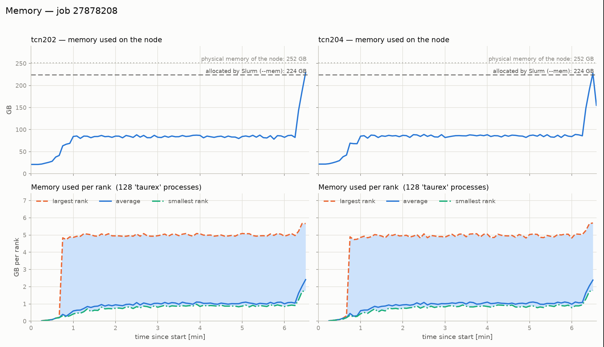

# Summary

TauREx 3 [@alrefaie2021] is an open-source Python framework for modelling and retrieving the atmospheres of exoplanets. It builds self-consistent forward models of transit, eclipse, and phase-curve observations from a pressure–temperature profile, a chemical composition, and a set of opacity and scattering contributions, and it compares these models against observed spectra within a Bayesian retrieval loop. TauREx 3 is used to interpret observations from HST, Spitzer, and JWST, and its plugin system lets users add forward models, chemistry, opacities, and samplers without modifying the core code.

TauREx 3.4, released alongside this paper, builds on 3.3.2. It reduces the memory footprint of high-resolution retrievals, accepts physical units on model inputs, promotes three formerly external plugins (multimodel forward models, instrument systematics, and precomputed Mie grids) into the core package, and adds a wavelength-aware flux binner. The memory improvements are the headline change: they allow retrievals with ExoMol line lists sampled at a resolving power of $R = 50{,}000$ to run on cluster nodes that previously exhausted their memory.

# Statement of need

High-resolution opacity data are now the limiting resource in exoplanet atmospheric retrievals. ExoMol [@tennyson2016] line lists sampled at $R = 50{,}000$ produce large cross-section tables, and the cost of holding one table per rank, plus the per-contribution intermediate spectra, grows quickly with the number of absorbing species. Before TauREx 3.4, a retrieval that combined several molecules with two cloud parameterisations at $R = 50{,}000$ exhausted the memory of the cluster nodes available to us. Version 3.4 removes this bottleneck by cutting each opacity to the observed spectral range, accumulating the contribution spectra into shared buffers instead of allocating one full spectrum per contribution, and loading opacity data into MPI shared memory so that each node stores one copy instead of one copy per rank.

The same release also improves the correctness and ergonomics of the framework. Physical units are now accepted throughout the input layer: planet radii, temperatures, pressures, orbital separations, and cloud-deck pressures can be given as Astropy quantities or unit-aware strings [@astropy2022], which removes a common source of unit errors in retrieval setups. The multimodel and instrument-systematics plugins [@changeat2025] and the precomputed-grid Mie contribution [@voyer2026] are now part of the core package, so composite forward models, systematic-error terms, and cheap multi-cloud retrievals no longer require separate plugin installations.

# State of the field

TauREx 3 sits alongside other open-source retrieval codes such as NEMESIS, CHIMERA, petitRADTRANS, and POSEIDON, which differ in their opacity handling, chemistry flexibility, and sampler support. TauREx 3 distinguishes itself by its plugin system, which allows new forward models, chemistry schemes, opacity formats, and samplers to be added without modifying the core code, and by its support for MPI-parallel retrievals with shared-memory opacity storage. Version 3.4 consolidates three widely used plugins into the core package and extends the framework to high-resolution opacity data, as described below.

# Software design

## Memory-efficient forward models

The forward model now applies the observed-grid cutoff to every opacity before the radiative-transfer calculation, so cross-sections are never held on wavenumber points outside the observed band. The transmission and emission models accumulate the optical depth of each contribution into a single working buffer, and the absorption and CIA contributions reuse pre-allocated arrays rather than allocating one full spectrum per species. Opacity and CIA tables are moved into MPI-3 shared memory, so a node keeps a single copy shared by all of its ranks. Together these changes allow the $R = 50{,}000$ W107 retrieval described below to run on four nodes with 224 GB per node, whereas the same setup exhausted memory before 3.4.

## Physical units on model inputs

Input values that carry an Astropy unit are normalised through a single helper, so planet radii, stellar and planetary temperatures, pressures, cloud-deck pressures, and spectral grids accept `Quantity` objects and unit-aware strings. This applies at the boundary of the user-facing API and leaves the internal computation in SI units.

## Precomputed-grid Mie clouds

`PyMieScattGridExtinction` promotes the former `taurex-PCQ` plugin into the core. Instead of computing Mie efficiencies on the fly at every model evaluation, it interpolates extinction from precomputed $Q_\mathrm{ext}$ grids stored in HDF5 [@voyer2026], which makes multi-cloud retrievals much cheaper and works in transmission, emission, and direct-imaging models.

## Built-in multimodel and instrument systematics

Composite forward models (weighted combinations of several forward models) and instrument-systematic observation loaders are now built into TauREx 3, so users can fit multiple atmospheric scenarios or add wavelength offsets and instrument models without installing separate plugins.

## Wavelength-aware flux binning

The flux binner was rewritten so that a single `FluxBinner` class bins spectra in either wavenumber or wavelength, replacing the previous wavenumber-only implementation while keeping the old behaviour available for backwards compatibility.

## Additional fixes

Version 3.4 also fixes a number of defects: pressure-unit handling in the ExoTransmit opacity reader, a log-transformation bug in the flat-Mie cloud parameter, a bug in the emission model, broken posterior PDFs for Guillot retrievals, and an inheritance bug in the optimiser mixin that could shadow fitting parameters.

# Research impact statement

TauREx 3 has been the retrieval framework behind a large number of published exoplanet atmosphere studies since its 2021 release [@alrefaie2021; @alrefaie2022]. Version 3.4 extends this impact to a regime that was previously out of reach: retrievals with high-resolution opacity data and multiple cloud parameterisations that previously exhausted available memory. We demonstrate this with a retrieval campaign on W107. The first experiment uses HST/WFC3; a second, planned experiment will use JWST.

<!-- TODO: add the W107 JWST figures once that run completes (placeholders below). -->

## W107 with HST/WFC3

We retrieved a fiducial HST/WFC3 transmission spectrum of W107 (0.9–1.7 μm, 30 spectral bins). The forward model combines ExoMol line lists sampled at $R = 50{,}000$, an 80-layer pressure grid from $1 \times 10^{-2}$ to $1 \times 10^{6}$ Pa, constant mixing ratios of H$_2$O, CO, CO$_2$, and CH$_4$, Rayleigh scattering from H$_2$ and He, collision-induced absorption from H$_2$–H$_2$ and H$_2$–He, and two cloud parameterisations fitted simultaneously: a Lee–Mie deck [@lee2013] and a flat grey deck. Eleven parameters were fitted with MultiNest [@feroz2009] using 302 live points and an evidence tolerance of 0.5. The run used 256 MPI ranks across four nodes, reached a peak memory use of 702 GB in total (203 GB on the busiest node of a 224 GB-per-node allocation), and finished in 13.8 minutes of wall-clock time.

The retrieval converges to a Bayesian log-evidence of $\ln Z = 229.1 \pm 0.2$. The marginal posteriors give a planet radius of $R_p = 0.916 \pm 0.009\ R_J$, an isothermal temperature of $T = 372 \pm 89$ K, and fitted logarithmic mixing ratios of $\log_{10} X_{\mathrm{H_2O}} = -3.9 \pm 0.9$, $\log_{10} X_{\mathrm{CO}} = -7.2 \pm 2.9$, $\log_{10} X_{\mathrm{CO_2}} = -8.3 \pm 2.3$, and $\log_{10} X_{\mathrm{CH_4}} = -8.6 \pm 2.1$. The Lee–Mie deck is constrained to a particle radius of $\log_{10}(r/\mu\mathrm{m}) = -1.1 \pm 1.9$, an extinction coefficient $q = 46 \pm 31$, a top pressure of $\log_{10}(P_\mathrm{top}/\mathrm{Pa}) = 1.4 \pm 2.8$, and a number density of $\log_{10} X_\mathrm{Mie} = -16.3 \pm 9.1$; the flat deck has a top pressure of $\log_{10}(P_\mathrm{top}/\mathrm{Pa}) = 3.85 \pm 0.58$. The fit and the posterior distributions are shown in Figure \ref{fig:w107_spectrum} and Figure \ref{fig:w107_posteriors}; the contribution breakdown is shown in Figure \ref{fig:w107_contributions}, and the memory profile in Figure \ref{fig:w107_memory}.

{#fig:w107_spectrum width=90%}

{#fig:w107_posteriors width=90%}

{#fig:w107_contributions width=90%}

{#fig:w107_memory width=90%}

**[PLACEHOLDER — science lead]** Two or three sentences interpreting the retrieved abundances and cloud parameters in the context of W107: what the constrained chemistry and the two cloud decks imply about the atmosphere, and what could not have been measured without the $R = 50{,}000$ retrieval enabled by TauREx 3.4.

**[PLACEHOLDER — literature/comparison lead]** One or two sentences placing the retrieved radius ($0.916 \pm 0.009\ R_J$) and temperature ($372 \pm 89$ K) in the published W107 literature, with references.

## W107 with JWST (planned)

**[PLACEHOLDER — science lead]** We are preparing a second, higher-information-content retrieval of W107 using JWST observations. This section will report the same set of figures as the HST section (retrieved spectrum, posteriors, contribution breakdown, and memory profile), the corresponding posterior values and evidence, and a comparison of how the two instruments constrain the same model.

{#fig:w107_jwst_spectrum width=90%}

{#fig:w107_jwst_posteriors width=90%}

{#fig:w107_jwst_contributions width=90%}

# Software implementation and availability

TauREx 3 is implemented in Python and depends on NumPy [@numpy], SciPy [@scipy], Astropy [@astropy2022], and h5py. It is distributed on PyPI (`pip install taurex`) and supports Linux, macOS, and Windows. Documentation is published at https://taurex3.readthedocs.io, with example notebooks covering setup, forward modelling, clouds, binning, retrievals, multimodel fitting, and instruments. The source code is hosted at https://github.com/ucl-exoplanets/TauREx3 under the BSD-3-Clause licence and is developed under continuous integration with a pytest test suite.

# Conclusion

TauREx 3.4 removes the memory wall that blocked high-resolution, multi-cloud exoplanet retrievals, accepts physical units throughout the input layer, and folds three widely used plugins into the core package. Together with the W107 campaign described above, these changes make the framework ready for the data volumes of JWST and for high-resolution opacity databases such as ExoMol.

# Acknowledgements

The authors would like to acknowledge the Netherlands eScience Center for the funding provided under grant number NLESC.OEC.2025.146.
[PLACEHOLDER — funding acknowledgements, e.g. eScience Center grant and UCL/ESA/ERC funding.]

# AI Usage Disclosure

[PLACEHOLDER — the authors must complete this disclosure truthfully. A generative AI assistant drafted portions of this manuscript; the authors reviewed and take responsibility for all content.]

# References
